# HeartRate Broadcaster

One app for an indoor cycling setup: heart rate, the power meters, the trainer's
gears, and the workout itself.

Your Apple Watch and AirPods Pro 3 already measure your heart rate, and nothing
else can read them — training apps and bike computers expect a Bluetooth chest
strap. This app bridges the two. It reads live heart rate from the watch and the
AirPods, reconciles them into a single reading, and rebroadcasts it as a
standard Bluetooth LE Heart Rate Service. MyWhoosh, Zwift, TrainerRoad, Wahoo,
and Bluetooth-capable Garmin Edge units see an ordinary strap.

It also pairs the power meters, records the ride, and — over the open Bike
Control protocol — offers itself to a cycling app on the same Wi-Fi as a
shifter, which is the piece nothing else on the phone does.

<https://heart-rate.atsignhandle.xyz> · <https://hrb.atsignhandle.xyz>

<table>
  <tr>
    <td>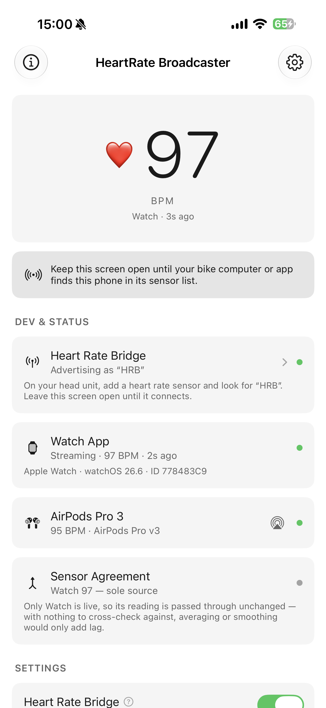</td>
    <td>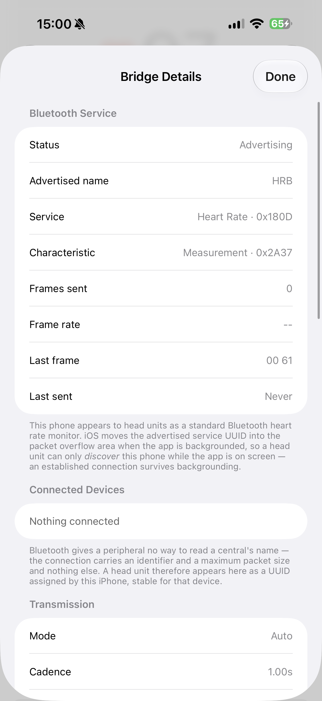</td>
    <td>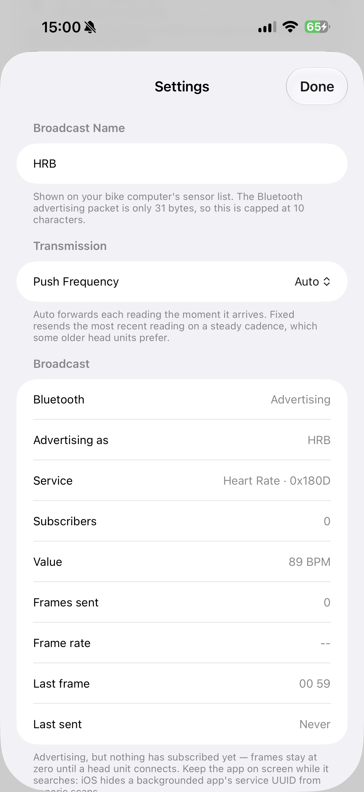</td>
    <td>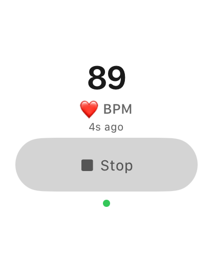</td>
    <td>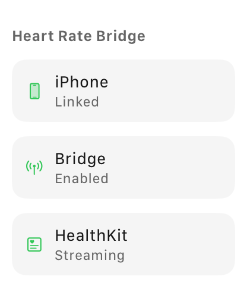</td>
  </tr>
  <tr>
    <td colspan="3"><sub>iPhone — live reading, a connected head unit, and the Bluetooth detail behind it</sub></td>
    <td colspan="2"><sub>Watch — the workout session and its touch lock</sub></td>
  </tr>
  <tr>
    <td>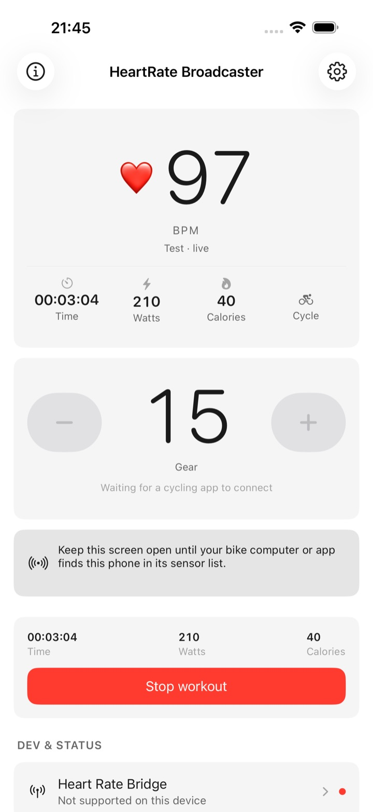</td>
    <td>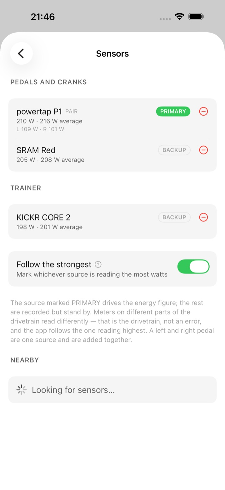</td>
    <td>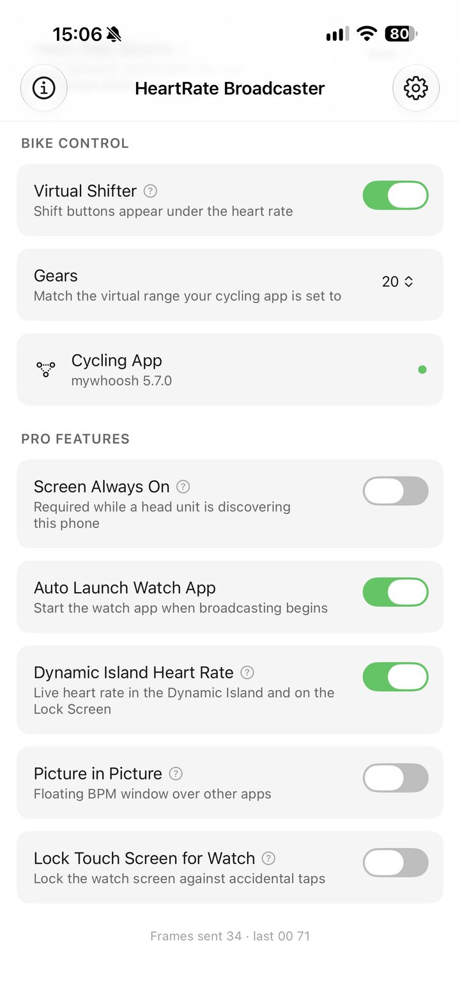</td>
    <td colspan="2"><sub>Mid-ride, the sources behind the watts, and the game that is listening. The sensors screen is a simulator render — a simulator has no Bluetooth radio, so the meters in it are fabricated, but the grouping, the arithmetic and the PRIMARY mark are the app's own.</sub></td>
  </tr>
  <tr>
    <td>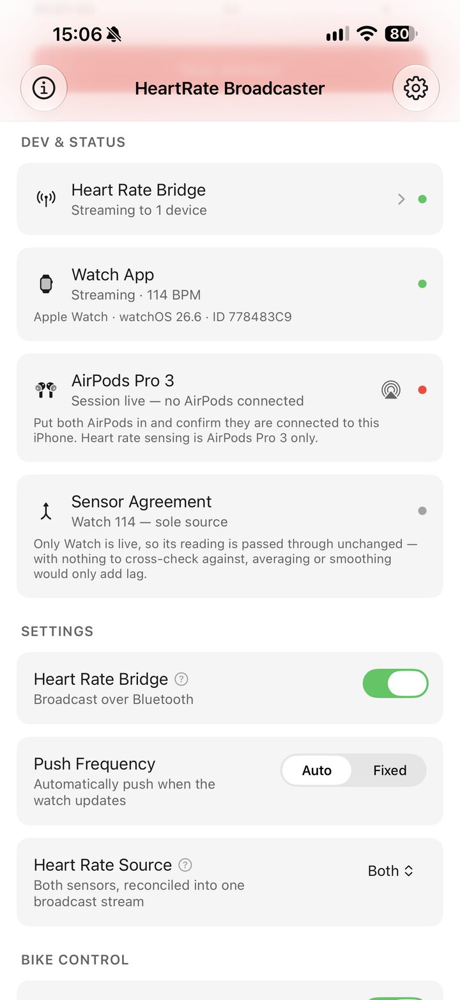</td>
    <td>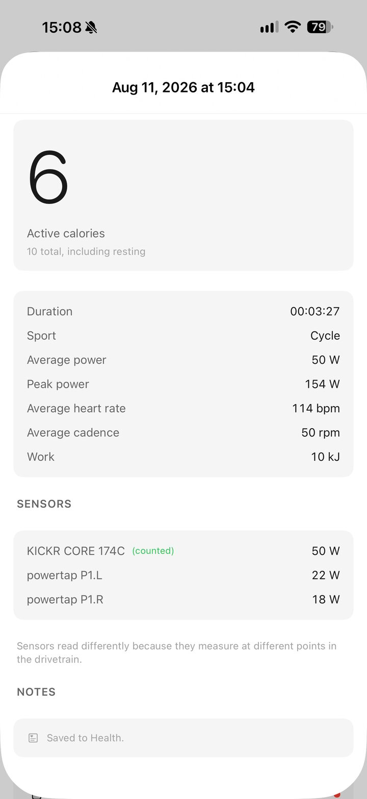</td>
    <td>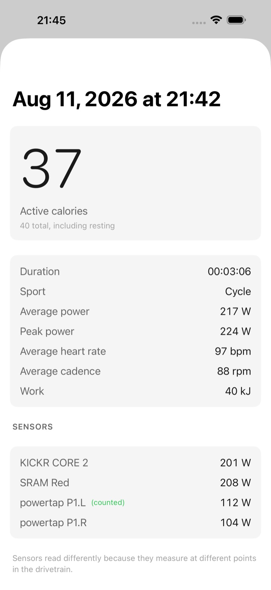</td>
    <td colspan="2"><sub>Off a phone with the meters actually connected: the trainer reads 50 W and is marked counted, the two pedals read 22 W and 18 W, which is one rider's two legs.</sub></td>
  </tr>
</table>

## How it works

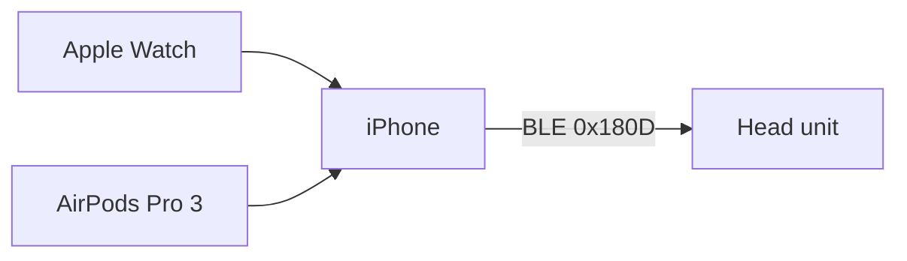

- **Apple Watch** runs an `HKWorkoutSession`. That is the only way to sample
  heart rate at a useful rate and to keep sampling with the screen off. Samples
  cross to the phone over `WCSession`.
- **AirPods Pro 3** report heart rate to whichever device runs the workout
  session, so the phone starts one of its own via `HKLiveWorkoutBuilder`. There
  is no dedicated AirPods heart rate API; this is the whole mechanism, and it is
  why the deployment target is iOS 26.
- **The iPhone** arbitrates. `HeartRateFusion` averages readings that agree and
  rejects the outlier when they disagree, preferring whichever is closer to the
  trend it has already seen. Exactly one number goes on the air. A reading that
  ages past the window stops counting, so the app never compares a live sensor
  against a stale one.
- **`CBPeripheralManager`** advertises the Heart Rate Service (`0x180D`) with
  Heart Rate Measurement (`0x2A37`) and Body Sensor Location, notifying once a
  second whether or not the value changed — which is what a real strap does and
  what head units expect.

## Power meters are grouped into sources

A left and a right pedal each measure one leg, so either one alone reads about
half of what a trainer reads — 30 W and 20 W at a pair of PowerTap P1s against
52 W at a KICKR CORE 2 is one rider at fifty-odd watts, not three meters
disagreeing. `Shared/PowerSource.swift` reads the paired list as sources rather
than meters, joining a left and a right of the same base name into one that
answers with their sum. A crank and a trainer stay separate: they measure the
same effort further down the drivetrain and are genuinely different numbers.

One source is marked `PRIMARY` and its watts drive the energy figure; the rest
are still recorded but stand by. `PrimaryMeterPicker` moves the mark to whichever
source is steadily reading highest — closest to the legs wins — unless the rider
chooses one by hand, which turns the automatic choice off. When one side of a
pair goes quiet for four seconds the survivor is doubled rather than the rider
being halved, and the row says so.

## Virtual shifting

`BikeControlService` announces the phone on the local network as a Bike Control
listener, implemented from the public OpenBikeControl specification. Nothing is
paired over Bluetooth for this and nothing leaves the network.

No game reports which gear it is in, so the two sides agree by the app stating
one. Games that advertise `gearSet` are told; MyWhoosh does not, so on connecting
to a game like that the counter snaps to 15 — where MyWhoosh opens every session
— and the two stay together as long as the shifting is done in the app.

### What it cannot do

Apple gives a third-party app no API to read a Bluetooth chest strap or another
phone's sensors, so this cannot import one. It broadcasts over Bluetooth LE
only; ANT+ is a separate radio that iPhones do not have. And a Bluetooth
peripheral is never told the name of the central that subscribed, so connected
head units appear by identifier rather than by label.

## Languages

The app and this site ship in twenty-five languages. `scripts/lib/locales.ts` is the
single source of truth for the list; `HeartRateBroadcaster/Models/AppLanguage.swift`
carries the same twenty-five in App Store listing order for the in-app picker,
and `web/src/i18n/` holds the twenty-four translated string tables for the site
(English is the source, so it has no file). Arabic is the only locale that
changes layout rather than just text.

Retranslate after editing English copy — the keys are the English strings
themselves, so an edit invalidates its own translations:

```bash
bun scripts/site/site.ts             # translate what changed, then build
bun scripts/site/site.ts --build-only  # rebuild without touching translations
```

## Layout

| Path | |
| --- | --- |
| `HeartRateBroadcaster/` | iOS app — views, BLE broadcaster, fusion, HealthKit, watch bridge |
| `HeartRateBroadcasterWatch/` | watchOS app — workout session, live view, touch lock |
| `HeartRateWidgets/` | Live Activity and Dynamic Island presentation |
| `LiveActivity/` | `ActivityAttributes` shared by the app and the widget extension |
| `Shared/` | Frame encoding and types used by more than one target |
| `Tests/` | Frame encoding, fusion arbitration, theme smoke tests |
| `scripts/` | Tooling, grouped by what it drives: `xcode/`, `appstore/`, `testflight/`, `media/`, `site/`, `lib/` |
| `web/` | Marketing page, deployed as a Cloudflare static-assets Worker |
| `docs/` | App Store Connect listing copy and the submission checklist |

`apple-project.json` holds every Apple identifier the build needs — team, bundle
IDs, certificates, API key and issuer — with a comment on each explaining what
it is for. It is gitignored; copy `apple-project.example.json` and fill it in.

`project.yml` is the source of truth. `HeartRateBroadcaster.xcodeproj` is
generated and is not committed — regenerate it rather than editing it.

## Building

Requires Xcode 26, [XcodeGen](https://github.com/yonaskolb/XcodeGen), and an
Apple Developer account for signing.

```sh
brew install xcodegen
cp apple-project.example.json apple-project.json   # fill in your own identifiers
scripts/xcode/gen-xcconfig.sh                      # writes signing.xcconfig
xcodegen generate
open HeartRateBroadcaster.xcodeproj
```

### What to fill in

Only the identity fields matter for building and sideloading. Everything else in
`apple-project.example.json` either already describes this repository — the
paths, the string catalogs, the App Store field limits — or belongs to steps you
will not run. Keys beginning with `//` are documentation; JSON has no comment
syntax, so every one of them explains the key beneath it.

| Key | Where it comes from | Needed for |
| --- | --- | --- |
| `team.id` | Apple Developer → Membership. Ten characters. | Building |
| `team.name` | The name on the account; appears in certificate common names. | Building |
| `team.appleId` | Xcode → Settings → Accounts. | Building |
| `app.bundleIdPrefix` | Reverse-DNS of a domain you control. | Building |
| `app.bundleId` | The App ID you registered on developer.apple.com. Must match the prefix. | Building |
| `app.extensions.*` | One registered App ID per embedded target, each a child of `app.bundleId`. | Building |
| `signing.developmentIdentity` | `security find-identity -v -p codesigning`, copied verbatim. | Signing |
| `signing.distributionIdentity` | Same command; the `Apple Distribution` line. | Archiving |
| `appStoreConnect.*` | Users and Access → Integrations. | Uploading only |
| `account.*`, `review.*`, `listing.*` | Your own contact and listing copy. | Submitting only |
| `site.*` | Your own domain, if you deploy the marketing page. | The web page only |

The bundle identifier has to be one **you** registered. Reusing
`xyz.atsignhandle.heart-rate-broadcaster` will fail at signing, because that App
ID belongs to another team.

A **paid** Apple Developer account is required. HealthKit and background
Bluetooth are both unavailable to free provisioning, so a free Apple ID produces
an app that installs and then does nothing — which is harder to diagnose than a
build that refuses to sign.

From the command line:

```sh
xcodebuild -project HeartRateBroadcaster.xcodeproj \
           -scheme HeartRateBroadcaster \
           -configuration Release \
           -destination 'generic/platform=iOS' \
           -allowProvisioningUpdates build
```

Tests:

```sh
xcodebuild test -project HeartRateBroadcaster.xcodeproj \
                -scheme HeartRateBroadcaster \
                -destination 'platform=iOS Simulator,name=iPhone 17 Pro'
```

Once it builds, `scripts/xcode/make-sideload-ipa.sh` archives Release and
exports an `.ipa` with the `release-testing` method — signed by your own
distribution identity, so it installs on any device your provisioning profile
covers, with no re-signing step.

## Scripts

| | |
| --- | --- |
| `scripts/media/make-app-icons.swift` | Renders the icon set from a single source |
| `scripts/media/prepare-screenshots.ts` | Resizes raw device captures to the exact sizes App Store Connect accepts, and publishes named web copies |
| `scripts/site/publish-press-kit.ts` | Curates the App Store screenshot set into `web/press/` with a machine-readable manifest |
| `scripts/xcode/make-sideload-ipa.sh` | Archives Release, exports an `.ipa`, and optionally cuts a GitHub release |
| `scripts/appstore/asc-upload.ts` | Uploads an `.ipa` to App Store Connect with `asc`, after checking the build number against Apple's |

The TypeScript scripts run under [Bun](https://bun.sh); the image ones need
ImageMagick. `scripts/lib/` is shared code, not entry points.

## Publishing depends on `asc`

Every upload goes through [`asc`](https://asccli.sh), the App Store Connect CLI.
This repository has no second upload path. `scripts/appstore/asc-upload.ts` calls
`asc` and stops if `asc` is absent.

```sh
brew install asc
asc auth login     # stores the API key in the macOS keychain
asc doctor         # confirms the key, the issuer and the team
```

`asc` replaced `xcrun altool`. The former `scripts/appstore/upload-build.sh` drove
`altool --validate-app` and `altool --upload-app`. `altool` reads the private key
by name from `~/.appstoreconnect/private_keys/`, so the `.p8` had to sit on disk
at a fixed path. `asc` resolves the key from its own keychain profile. No script
here accepts a key path, and no key reaches a command line.

### What the upload script reads

| Source | Values |
|---|---|
| `apple-project.json` — gitignored | `appStoreConnect.appleId`, `paths.scheme`, `app.marketingVersion` |
| `build_number.xcconfig` — committed | `CURRENT_PROJECT_VERSION` |
| `asc builds next-build-number` | the number Apple accepts next |

Every Apple identifier stays in `apple-project.json`. That file is gitignored and
has never been committed. The script carries no identifier of its own, so the
script is safe to publish.

The script does not pass a build number to `asc`. `asc` reads `CFBundleVersion`
from the archive, so the number that uploads is the number that was built. There
is no second source of truth.

Warning: a rejected upload still consumes the build number. Before it uploads,
the script compares the local number against the number Apple already holds. The
script refuses the upload when the local number is not ahead.

### The agent workflow

A Claude Code skill drives this workflow. Load the on-demand bundle, then name the
skill:

```
/on-demand:mobile     # provides asc, apple-init, apple-release
/asc                  # App Store Connect operations
```

`/on-demand:asc-extra` adds the narrow skills: build lifecycle, TestFlight
orchestration, metadata sync, crash triage, notarization. Each skill reads the
same gitignored `apple-project.json`, so an agent needs no credential of its own.

## The marketing page

```sh
bun scripts/site/site.ts         # writes web/dist — every page, in every language
cd web && bunx wrangler deploy
```

Static assets only, no server code. `web/dist/` is generated and gitignored, and
is the only directory the deploy uploads — see `web/README.md`.

## Installing

Three routes to the same app. There is no free edition and no in-app purchase —
the two free routes are the identical binary, reached by spending effort instead
of money.

| | Cost | Needs | Lasts |
| --- | --- | --- | --- |
| [TestFlight](https://testflight.apple.com/join/VUJCa5Gw) | Free | Apple's TestFlight app | 90 days per build |
| [Sideload](https://github.com/tankbottoms/HeartRateBroadcaster/releases) | Free | A paid Apple Developer account | Your provisioning profile |
| [App Store](https://apps.apple.com/app/id6797897649) | USD 4.99 once | Nothing | Indefinitely |

### TestFlight

The beta is public — no invitation, no code, and no approval step.

1. Install **TestFlight** from the App Store on the iPhone.
2. Open <https://testflight.apple.com/join/VUJCa5Gw> on that same iPhone, then
   tap Accept and Install.
3. Install the watch app from the Watch app on the iPhone. The watch is the
   sensor, so this step is not optional.

A build works for 90 days from the day it is published. Each new build restarts
that period, so the beta keeps running for as long as it is updated.

### Sideloading

Every [GitHub release](https://github.com/tankbottoms/HeartRateBroadcaster/releases)
carries a Release-configuration `.ipa`, built by `scripts/xcode/make-sideload-ipa.sh`.
It is signed for App Store distribution, so it will not install as shipped — it
has to be re-signed with your own identity.

HealthKit and background Bluetooth are not available to free provisioning
profiles, so this route needs a **paid Apple Developer account**. A free Apple ID
will sign the app and then fail at runtime, which is worse than not installing.

<details>
<summary>Xcode</summary>

1. Download `HeartRateBroadcaster.ipa` from the release.
2. Rename it to `.zip`, unzip, and take `Payload/HeartRateBroadcaster.app`.
3. Open **Xcode → Window → Devices and Simulators**, select the connected
   iPhone, and drag the `.app` into *Installed Apps*.

Xcode re-signs with the identity of whichever team the app's bundle identifier
is registered to, so change `PRODUCT_BUNDLE_IDENTIFIER` if it collides with the
store build.
</details>

<details>
<summary>Sideloadly or AltStore</summary>

1. Download `HeartRateBroadcaster.ipa` from the release.
2. Open it in Sideloadly (macOS or Windows) or AltStore, and sign in with the
   Apple ID that holds your developer membership.
3. Install to the connected iPhone. The signature lasts as long as the
   provisioning profile does — a year for a paid account.
</details>

Building from source is the other free route, and avoids re-signing entirely:
clone, fill in `apple-project.json` as described under
[Building](#building), run `scripts/xcode/gen-xcconfig.sh && xcodegen generate`,
and build to the device.

### App Store

USD 4.99, paid once. No subscription, no in-app purchase, no ads, no account,
and it updates itself. It is the convenient route and nothing more — the app is
the same.

## Requirements

iOS 26 or later. watchOS 11 or later for the watch app. AirPods Pro 3 for the
AirPods source; they are optional, and the watch on its own is a complete
source, as are the AirPods.
