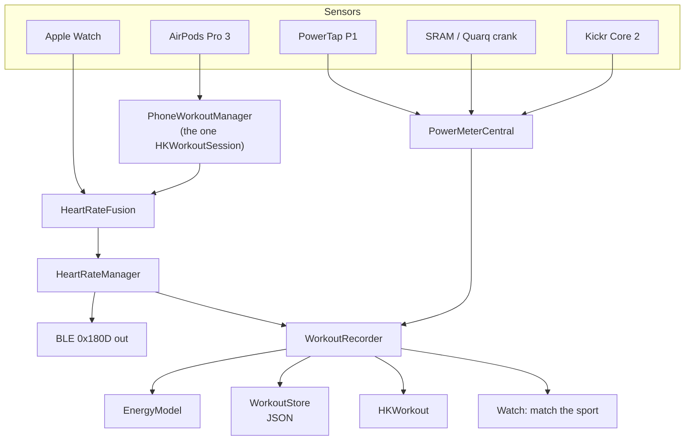

# Power meters, energy expenditure, and saved workouts

2026-08-10

## What this adds

The app is a heart rate bridge. It reads the watch and the AirPods, reconciles
them, and rebroadcasts one number over Bluetooth LE. It records nothing.

This adds the other half of a training session:

- **Power meters.** The app takes on the Bluetooth *central* role and subscribes
  to Cycling Power, Cycling Speed and Cadence, and Fitness Machine broadcasts.
- **A body profile.** Weight, height, date of birth and sex, so energy
  expenditure can be computed rather than guessed.
- **Sessions.** An explicit Start and Stop with a sport — bike, run or swim —
  saved to Apple Health *and* to a history inside the app.

## Decisions taken

| Question | Decision |
| --- | --- |
| Where do saved sessions live | Apple Health **and** an in-app history |
| What produces the kcal figure | Power when a meter is present, heart rate when it is not |
| When is the sport chosen | Up front, at Start; Bike preselected when a power meter is subscribed |
| Which Bluetooth services | Cycling Power `0x1818`, Cycling Speed and Cadence `0x1816`, Fitness Machine `0x1826` |
| Fitness Machine control | **No.** Data only. No resistance or ERG control |
| Which meter's watts count | The one marked primary; the others are recorded alongside for comparison |
| Does the watch participate | The phone owns Start/Stop; the watch is told the sport and follows |
| Structure | A `WorkoutRecorder` beside `HeartRateManager`, sessions persisted as JSON |

### Why not fuse the power meters

`HeartRateFusion` averages two sensors that are trying to measure the same
quantity, and rejects the outlier. Power meters are not that case. A PowerTap P1
pedal measures at the pedal, a Quarq crank measures downstream of it, and a Kickr
Core measures downstream of the whole drivetrain — each reading is correct for
where it sits, and the differences between them are drivetrain losses, not error.
Averaging them would produce a number that describes no point on the bike.

So one meter is primary and drives the arithmetic. The others stay subscribed and
their samples are recorded, which makes the offset between them visible after a
ride instead of dissolving it into the figure.

## The constraint that shapes everything

iOS permits **one `HKWorkoutSession` per device**, and `PhoneWorkoutManager`
already runs one. That session is not incidental — it *is* the AirPods Pro 3
mechanism, because AirPods report heart rate to whichever device is running a
workout. A second session cannot be started.

The design is therefore **one session with two consumers**, not two sessions.

`PhoneWorkoutManager` keeps everything that makes it good — the audio-route
detection, the `Progress` vocabulary that distinguishes "session starting" from
"nothing is wearing the AirPods", the sample ingestion. What it gives up is
ownership of the session's *configuration* and its *fate*:

- It gains an injected `HKWorkoutConfiguration` instead of hardcoding
  `.cycling` / `.indoor`.
- `builder.discardWorkout()` — whose comment reads *"this app is a sensor bridge,
  not a training log … discarding avoids littering Health with phantom rides"* —
  becomes conditional. Bridging still discards. A recording finishes and saves.

That comment was right when it was written and is the thing this feature
reverses; the reversal belongs in one place, guarded, rather than spread.

This is also why the sport has to be chosen before Start rather than at the
summary screen: `HKWorkoutConfiguration.activityType` is fixed at session
creation and cannot be changed while it runs.

## Structure

The test target compiles `Tests` and `Shared` and nothing else. Every unit whose
correctness is worth asserting therefore lives in `Shared/`, and only the units
that must touch CoreBluetooth, HealthKit or the file system live in the app
target. No change to `project.yml` is needed for any of it.

### `Shared/` — pure, tested, no frameworks

| Unit | Responsibility |
| --- | --- |
| `CyclingPowerMeasurement` | Parses `0x2A63`: flag word, `sint16` instantaneous watts, optional pedal power balance, optional crank revolution data |
| `CSCMeasurement` | Parses `0x2A5B`: cumulative wheel and crank revolutions with their event times |
| `IndoorBikeData` | Parses FTMS `0x2AD2`: flag word, instantaneous speed, cadence, power |
| `CadenceTracker` | Turns successive cumulative-revolution samples into rpm, handling the 16-bit rollover |
| `BodyProfile` | Mass, height, date of birth, sex; age; Mifflin-St Jeor basal rate |
| `EnergyModel` | Joules to kilocalories; the Keytel heart-rate estimate; the active-versus-resting split |
| `WorkoutRecord` | The `Codable` session: sport, bounds, samples, gaps, totals |

### App target — I/O

| Unit | Responsibility |
| --- | --- |
| `PowerMeterCentral` | `CBCentralManager`. Scans the three services, connects, reconnects to known meters by identifier, publishes samples |
| `MeterRegistry` | Which meters are paired, which is primary, what kind each one is |
| `WorkoutRecorder` | The session: Start, Stop, sample accumulation, running energy, the watch handoff, the save |
| `WorkoutStore` | One JSON file per session plus an index, and the crash journal |

`HeartRateManager` gains a single `recorder` property and one call from
`publishFused`. It does not otherwise change.

### Views

| View | Where |
| --- | --- |
| `SessionControlCard` | Top of `ContentView` — Start/Stop, sport picker, elapsed, live watts and kcal |
| `SessionSummaryView` | Presented on Stop |
| `WorkoutHistoryView`, `WorkoutDetailView` | Reached from `ContentView` |
| `PairedMetersView` | Settings — discovered and paired meters, primary selection |
| `BodyProfileView` | Settings — weight, height, date of birth, sex, units |

## Data flow



Heart rate reaches the recorder already reconciled — the recorder never sees two
heart rates and never re-litigates which sensor was right. Power reaches it
un-arbitrated, tagged by meter, and the recorder keeps the primary's samples for
arithmetic and the rest for the record.

## Energy

Four profile fields, each earning its place.

### With power

Mechanical work is the integral of watts over time. Metabolic cost is that work
divided by gross efficiency:

```
joules      = Σ watts · Δt          (primary meter only, gaps excluded)
kilocalories = joules / (η · 4184)   η = 0.24
```

η of 0.24 sits in the middle of the measured range for trained cyclists, and it
is what makes the familiar shorthand — a kilojoule of work costs about a
kilocalorie — come out. It is written as a named constant rather than as a
multiplication by one, so it can be disagreed with.

### Without power

Keytel et al. (2005), in kilocalories per minute, from heart rate, mass in
kilograms and age in years:

```
male    (-55.0969 + 0.6309·HR + 0.1988·kg + 0.2017·age) / 4.184
female  (-20.4022 + 0.4472·HR - 0.1263·kg + 0.0740·age) / 4.184
```

Clamped at zero. Where Health reports sex as other or not set, the two
coefficient sets are averaged, and the profile screen says so rather than
choosing silently.

### Active versus resting

Health's `activeEnergyBurned` means energy above resting. Mifflin-St Jeor gives
the resting rate, which is where height enters:

```
BMR   male    10·kg + 6.25·cm - 5·age + 5      kcal/day
BMR   female  10·kg + 6.25·cm - 5·age - 161    kcal/day

active = total - BMR · duration
```

Both figures are shown. Only `active` is written to Health, which is what
prevents this app's number from double-counting against the Fitness rings.

## Dropout is not coasting

A Cycling Power meter notifies about once a second whether or not you are
pedalling, and a coast reports a real zero watts. That zero belongs in the
integral. Silence does not.

- Connected, notifying, zero watts → coasting. Counts.
- Connected, no notification for more than 3 seconds → **gap**.
- Disconnected → **gap**.

Gaps are excluded from the integral, recorded on the session with their bounds,
and surfaced on the summary. Without this rule a break in the café reads as an
hour of soft-pedalling, and the kcal figure quietly inflates.

## Failure

| Failure | Behaviour |
| --- | --- |
| Bluetooth off or unauthorised | Central state maps to the same vocabulary `BLEBroadcaster` already uses; the sport picker still works and the session records heart rate alone |
| Meter disconnects mid-session | Gap opens, session continues, automatic reconnect by identifier; the summary names the meter and the lost time |
| Primary meter never appears | Session falls back to the heart-rate estimate and says which model produced the number |
| Health write refused | The session is still recorded locally and still visible in the history; the summary states that Health was not written, once, without nagging |
| App terminated mid-session | The journal on disk is replayed at launch and the session is offered for recovery rather than lost |
| Two sessions requested | Impossible by construction — Start is disabled while a session runs |

Exactly one `HKWorkout` is written per session, at finish. Nothing is written on
Start, so an abandoned session leaves Health untouched.

## Testing

Everything in `Shared/` is a pure function and gets asserted directly. Nothing in
the test target touches CoreBluetooth, HealthKit or the file system.

- **Parsers.** Table-driven, from captured packets: flags present and absent,
  pedal balance present, crank data present, the 16-bit revolution rollover,
  truncated and malformed payloads returning `nil` rather than trapping. This is
  where the bugs are — byte-level optional fields — and the tests are cheap.
- **`CadenceTracker`.** Rollover, a stalled crank, a first sample with no
  predecessor.
- **`EnergyModel`.** Known inputs against hand-computed outputs, both models,
  both sexes, the averaged case, the clamp at zero, and the active/resting split.
- **`WorkoutRecord`.** `Codable` round trip, including gaps and an empty session.
- **`WorkoutRecorder` state machine.** Driven by an injected clock and a sample
  feed, with the HealthKit and store dependencies behind protocols — Start, Stop,
  gap open and close, source fallback, double-Start rejection.

The existing `HeartRateFusionTests`, `HeartRateFrameTests` and `ThemeSmokeTests`
are untouched.

## Localisation

The app ships 259 keys in 25 languages. This adds roughly 70 — sport names, the
session controls, the profile fields, the meter list, the summary, the failure
sentences. Every one goes through `String(localized:comment:)` with a comment, as
the existing code does, and the catalog is filled before release rather than
after.

## Deliberately excluded

- **Fitness Machine control.** Reading a Kickr is a sensor. Commanding one is a
  different product with a different review posture.
- **Starting a session from the watch.** The phone owns Start and Stop.

  Swimming is the case this costs. The phone does tell the watch to run
  `.swimming`, so water lock and the watch's own swim handling are real — but the
  phone cannot come in the water, Bluetooth does not cross it, and the watch's
  samples arrive in a burst when the two devices meet again. A logged swim is
  therefore a watch recording that the phone reassembles afterwards, with a gap
  spanning the swim itself. The summary says this in words rather than presenting
  a smooth line that was never measured. Starting from the wrist is what would
  fix it, and it is a later piece of work.
- **Export.** No FIT, TCX or CSV. The history is a list, and Health is the
  interchange format.
- **Charts.** The detail screen reports totals, averages and gaps. Plotting is a
  separate piece of work.
